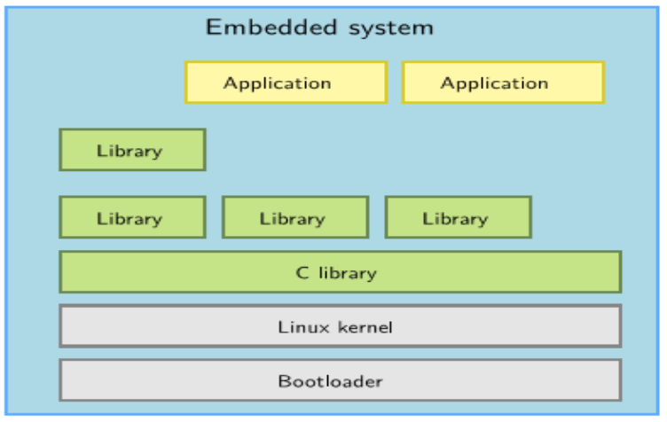

# Pratique 02 : Construction manuelle d'un système Linux embarqué pour STM32MP157

Le focus de cette seconde pratique est de préparer, élément par élément, un système Linux embarqué afin de bien comprendre les différents composants du système. 



Vous testerez le démarrage de votre système et modifierez la configuration du noyau Linux

4 éléments vont être utilisés dans ce TP :

* u-boot 
* TF-a
* noyau Linux
* rootfs debian


## Pré-requis
- avoir une chaine de cross compilation ARM (installée au TP1)
- Utiliser un système récent de Debian, Fedora ou Ubuntu sur un PC x86 64bit (installé au TP1)


## Préparons la cross compilation

Pour indiquer au système que nous souhaitons cross compiler pour un processeur ARM en EABI sans Hard Float :

```shell
user@hostname:$ sudo apt update
user@hostname:$ sudo apt install lz4 build-essential fakeroot gettext bison flex pkg-config libmpc-dev u-boot-tools libncurses-dev:amd64 libssl-dev:amd64
user@hostname:$ sudo apt install gcc-arm-linux-gnueabi swig python3-pip python3-distutils
user@hostname:$ export CC=arm-linux-gnueabi-
```

Test Cross Compiler:

```shell
user@hostname:$ ${CC}gcc --version
```
## utilisation des données de la stm32mp157c-dk2

Dans la suite de ce TP, nous allons nous servir des définitions de la carte d'évaluation stm32mp157c-dk2.

ST n'ayant pas fait de remontée en mainline pour notre carte, les données de configuration / device tree de la stm32mp157f-dk2 que nous utilisons ne sont pas disponibles. 

Les 2 processeurs (STM32MP157F et STM32MP157C) ainsi que les cartes de développement étant assez proche les uns des autres, nous pouvons utiliser cette équivalence.

En effet, la seule grosse différence entre les 2 processeurs est que le STM32MP157F est équipé d'une unité de cryptographie, que nous ne mettrons pas en oeuvre dans nos TP.

Créons le répertoire de travail pour ce TP:

```shell
user@hostname:$ mkdir TP02
user@hostname:$ cd TP02
```

## Linux Kernel
Le script que vous allez utiliser construit le noyau, les modules et les device tree. Il copie ensuite tous ces éléments dans le répertoire de déploiement *deploy*.

### Téléchargement
```shell
user@hostname:$ git clone https://github.com/RobertCNelson/armv7-lpae-multiplatform ./kernelbuildscripts
user@hostname:$ cd kernelbuildscripts/
user@hostname:$ git checkout origin/v5.15.x -b tmp
```

### Configuration & compilation
```shell
user@hostname:$ ./build_kernel.sh
```

Ne rien changer à la configuration quand le menu s'ouvre. Simplement quitter le menu, en enregistrant la configuration.
```shell
  CC      kernel/sys.o
  CC      drivers/clk/imx/clk-divider-gate.o
  CC [M]  net/sched/act_gact.o
  CC      net/core/dev_ioctl.o
  CC      drivers/video/videomode.o
  CC      drivers/clk/imx/clk-fixup-div.o
  CC [M]  sound/soc/codecs/twl6040.o
  AS      arch/arm/lib/ashldi3.o
  AS      arch/arm/lib/ashrdi3.o
  AS      arch/arm/lib/backtrace.o
  AS      arch/arm/lib/bswapsdi2.o
```

en fin de build vous devriez voir ceci :

``` shell
-----------------------------
Script Complete
eewiki.net: [user@localhost:~$ export kernel_version=5.15.148-armv7-lpae-x42]
```
gardez pour plus tard cette ligne de commande

``` shell
# remontez à la racine de TP02
user@hostname:$ cd ..
```

## Bootloader: U-Boot

### Téléchargement
```shell
user@hostname:$ git clone -b v2022.10 https://github.com/u-boot/u-boot --depth=1
user@hostname:$ cd u-boot/
```
### Configuration
```shell
user@hostname:$ make ARCH=arm CROSS_COMPILE=${CC} distclean
user@hostname:$ make ARCH=arm CROSS_COMPILE=${CC} stm32mp15_trusted_defconfig
```
### Compilation

```shell
user@hostname:$ make ARCH=arm CROSS_COMPILE=${CC} DEVICE_TREE=stm32mp157c-dk2 all
```
### Vérification
Vérifiez que le bootloader est correctement compilé et disponible :
```shell
user@hostname:$ file u-boot.bin 
u-boot.bin: COM executable for DOS
# remontez à la racine de TP02
user@hostname:$ cd ..
```

## Bootloader: Trusted Firmware A (TF-A)

Trusted Firmware A (TF-A): https://developer.trustedfirmware.org/dashboard/view/6/

### Téléchargement
```shell
user@hostname:$ git clone -b v2.5 https://github.com/ARM-software/arm-trusted-firmware --depth=1
user@hostname:$ cd arm-trusted-firmware/
```

### Configuration & compilation
```shell
user@hostname:$ make CROSS_COMPILE=${CC} realclean
user@hostname:$ make CROSS_COMPILE=${CC} PLAT=stm32mp1 ARCH=aarch32 ARM_ARCH_MAJOR=7 AARCH32_SP=sp_min DTB_FILE_NAME=stm32mp157c-dk2.dtb STM32MP_SDMMC=1
```
### Vérification
Vérifiez que le bootloader est correctement compilé et disponible :
```shell
user@hostname:$ file build/stm32mp1/release/tf-a-stm32mp157c-dk2.stm32
# sortie possible
build/stm32mp1/release/tf-a-stm32mp157c-dk2.stm32: data
# remontez à la racine de TP02
user@hostname:$ cd ..
```

## Root File System
Debian 11

| User | Password |
|:----:|:--------:|
| debian | temppwd |
| root | root |


### Téléchargement

```shell
user@hostname:$ wget -c https://rcn-ee.com/rootfs/eewiki/minfs/debian-11.5-minimal-armhf-2022-10-06.tar.xz
```

### Verification

```shell
user@hostname:$ sha256sum debian-11.5-minimal-armhf-2022-10-06.tar.xz
#sha256sum output:
0ea53b23483af4bcccca53f3fd907b5e404f2f607a6577d78e8c4daf5b869ad0  debian-11.5-minimal-armhf-2022-10-06.tar.xz
```

### Extraction

```shell
user@hostname:$ tar xf debian-11.5-minimal-armhf-2022-10-06.tar.xz
```
## checkpoint 
 

Arrivés à ce stade, dans votre répertoire TP02, vous devriez avoir 4 sous répertoires :

```
TP02
├── arm-trusted-firmware
├── debian-11.5-minimal-armhf-2022-10-06
├── kernelbuildscripts
└── u-boot
```
Si vous n'avez pas cette arborescence, n'engagez pas la suite du travail et faites le point avec Sébastien ou Laurent

## Création des partitions 
commençons par exporter le nom de notre image pour la suite
```shell
user@hostname:$ export DISK=myrootfs.img
```

L'utilitaire kpartx permet de créer des périphériques blocs virtuels. Installez-le pour une utilisation prochaine 
```shell
user@hostname:$ sudo apt install kpartx
```
Créez un fichier de 2GB rempli de '0'
```shell
user@hostname:$ dd if=/dev/zero of="$DISK" bs=1k count=2000000
```

L'utilitaire sgdisk va permettre de créer 4 partitions dans ce fichier de 2 GB.

Les partitions créées ont des labels spécifiques.

### fsbl1 (Partition 1)

Secteurs : 34-545
le First Stage Bootloader 1 (FSBL1), qui sera peuplée avec le TF-a

### fsbl2 (Partition 2)
Secteurs : 546-1057
Second First Stage Bootloader (FSBL2), une redondance en cas d'échec du FSBL1, qui sera également peuplé avec le TF-a

### ssbl (Partition 3)
Secteurs : 1058-5153
Second Stage Bootloader (SSBL), qui sera peuplée par u-boot

### rootfs (Partition 4)
Secteurs : 5154- (jusqu'à la fin du disque)

Contient le système de fichiers root (Root File System) du système d'exploitation.


```shell
user@hostname:$  sudo sgdisk --resize-table=128 -a 1 \
        -n 1:34:545    -c 1:fsbl1   \
        -n 2:546:1057  -c 2:fsbl2   \
        -n 3:1058:5153 -c 3:ssbl    \
        -n 4:5154:     -c 4:rootfs  \
        -p ${DISK}
```

Ajoutez un format amorçable 
```shell
user@hostname:$ sudo sgdisk -A 4:set:2 ${DISK}

```
Utilisez maintenant kpartx pour rendre ces partitions accessibles par le système.

```shell
user@hostname:$ sudo kpartx -av "$DISK"
```
vous devriez obtenir une sortie de ce genre :
```shell
add map loop14p1 (252:0): 0 512 linear 7:14 34
add map loop14p2 (252:1): 0 512 linear 7:14 546
add map loop14p3 (252:2): 0 4096 linear 7:14 1058
add map loop14p4 (252:3): 0 1594813 linear 7:14 5154
```
Notez qu'ici le loop number est 14, il sera probablement différent sur votre système. Dans la suite des commandes, nous remplaçons ce nombre par un X. Charge à vous de modifier les commandes pour qu'elles correspondents à votre environnement.

### installation du Bootloader 
le TF-a a été compilé précédemment, il se trouve dans le répertoire arm-trusted-firmware. Ecrivez le dans les 2 partitions fsbl1 et fsbl2

``` shell
user@hostname:$ sudo dd if=./arm-trusted-firmware/build/stm32mp1/release/tf-a-stm32mp157c-dk2.stm32 of=/dev/mapper/loopXp1
user@hostname:$ sudo dd if=./arm-trusted-firmware/build/stm32mp1/release/tf-a-stm32mp157c-dk2.stm32 of=/dev/mapper/loopXp2
```
Le bootloader u-boot a également été compilé précédemment. Ecrivez le dans la partition ssbl

```shell
user@hostname:$ sudo dd if=./u-boot/u-boot.stm32 of=/dev/mapper/loopXp3
```


### Installation du rootfs
La partition 4 (rootfs) va être peuplée par le noyau linux, le device tree et le file system debian, cross compilé ARM et téléchargé au préalable.

#### Formattage de la partition 4
Formattez la partition 4 en ext4 (système de fichier journalisé)

``` shell
user@hostname:$ sudo mkfs.ext4 -L rootfs /dev/mapper/loopXp4
```

#### Montage de la partition 4
Créez un point de montage et montez la partion 4 pour pouvoir y écrire les fichiers
``` shell
user@hostname:$ sudo mkdir -p /media/rootfs/
user@hostname:$ sudo mount /dev/mapper/loopXp4 /media/rootfs/
```

Utilisez ici la version indiquée en fin de build à l'étape précédente. Cette version pouvant changer régulièrement, il est important de ne pas "bêtement" copier/coller ce qui était écrit plus haut mais bien de copier/coller ce que votre build a retourné.

Il est donc temps d'exporter cette variable dans votre environnement pour la suite des commandes

``` shell
user@hostname:$ export kernel_version=5.X.Y-Z
```
#### Copie du système de fichiers (rootfs)
Décompressez le système de fichier debian ARM dans votre point de montage

``` shell
user@hostname:$ sudo tar xfvp ./debian-*-*-armhf-*/armhf-rootfs-*.tar -C /media/rootfs/
user@hostname:$ sync
```
le bootloader u-boot va s'appuyer sur un fichier du rootfs pour obtenir les informations à passer au noyau, ainis que l'endroit où trouver le noyau et le device tree.

Créez ce fichier extlinux.conf et ajoutez les informations utiles

``` shell
user@hostname:$ sudo mkdir -p /media/rootfs/boot/extlinux/
user@hostname:$ sudo sh -c "echo 'label Linux ${kernel_version}' > /media/rootfs/boot/extlinux/extlinux.conf"
user@hostname:$ sudo sh -c "echo '    kernel /boot/vmlinuz-${kernel_version}' >> /media/rootfs/boot/extlinux/extlinux.conf"
user@hostname:$ sudo sh -c "echo '    append console=ttySTM0,115200 root=/dev/mmcblk0p4 ro rootfstype=ext4 rootwait' >> /media/rootfs/boot/extlinux/extlinux.conf"
user@hostname:$ sudo sh -c "echo '    fdtdir /boot/dtbs/${kernel_version}/' >> /media/rootfs/boot/extlinux/extlinux.conf"
```
Notez la différence entre la première commande *echo* et les 2 suivantes. La première comporte un unique > indiquant de commencer le fichier avec cette ligne. Les 2 autres comportent un >> qui indique d'écrire les informations à la suite, et non pas au début du fichier.

#### Copie du noyau

``` shell
user@hostname:$ sudo cp -v ./kernelbuildscripts/deploy/${kernel_version}.zImage /media/rootfs/boot/vmlinuz-${kernel_version}
```
#### Copie des device trees compilés

``` shell
user@hostname:$ sudo mkdir -p /media/rootfs/boot/dtbs/${kernel_version}/
user@hostname:$ sudo tar xfv ./kernelbuildscripts/deploy/${kernel_version}-dtbs.tar.gz -C /media/rootfs/boot/dtbs/${kernel_version}/
```

#### Copie des modules compilés

``` shell
user@hostname:$ sudo tar xfv ./kernelbuildscripts/deploy/${kernel_version}-modules.tar.gz -C /media/rootfs/
```

#### Création du fichier de gestion des points de montage (/etc/fstab)

``` shell
user@hostname:$ sudo sh -c "echo '/dev/mmcblk0p4  /  auto  errors=remount-ro  0  1' >> /media/rootfs/etc/fstab"
```

#### Démontage de la partition

``` shell
user@hostname:$ sync
user@hostname:$ sudo umount /media/rootfs
```

## Test du système
Votre système est maintenant prêt pour les tests
transférer votre fichier image via votre répertoire partagé dans votre système de fichier windows.

Utilisez win32diskimager pour écrire votre fichier sur la carte µSD.

Lorsque l'écriture est faite, insérez la carte µSD sur votre cible, et mettez sous tension. Vous devriez voir votre système démarrer.

Lorsque vous avez atteint le prompt, identifiez-vous (les infos ont été données plus haut).

vous devriez pouvoir obtenir la version du noyau actuellement en cours d'utilisation. 
``` shell
root@stm32mp157f-dk2:# uname -a
```
## checkpoint 
 
Votre système étant démarré, profitez-en pour faire valider cela par Sébastien ou Laurent

## Configuration du kernel
Essayez à présente de modifier la configuration du noyau, en changeant par exemple le nom de version du noyau.

Plutôt que de relancer le script de build complet utilisé plus haut pour construire le noyau, vous allez pouvoir utiliser ce script de rebuild, mis à disposition.

``` shell
user@hostname:$ cd kernelbuildscripts
user@hostname:$ ./tools/rebuild.sh
```

Lorsque l'écran de configuration s'ouvre, ajoutez par exemple vos initiales dans le champ local version du menu général.

Laissez ensuite la compilation se faire. Celle-ci devrait être plus courte.

Vous allez alors devoir modifier votre carte µSD pour y envoyer votre nouveau noyau, ainsi que les modules fraichement recompilés.

Appuyez vous sur les consignes précédentes pour ces opérations. 

Si vous avez des doutes notez les commandes que vous envisagez de faire et demandez conseil à Sébastien ou Laurent

## checkpoint 
 

Lorsque votre système est redémarré avec votre noyau modifié, faites le valider


