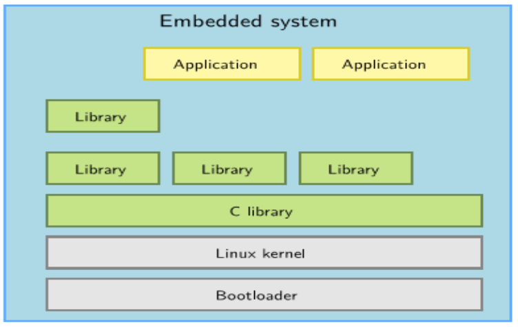
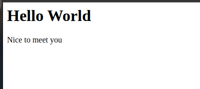

# Pratique 03 : Construction avec buildroot d'un système Linux embarqué pour STM32MP157

Le focus de cette troisième pratique est d'utiliser un system builder (buildroot) pour préparer un système Linux embarqué. 



Vous testerez le démarrage de votre système et modifierez la configuration de certains éléments du système

Nous allons utiliser un tuto de bootlin pour faire cette mise au point. En effet, ST fourni principalement à la communauté le nécessaire pour construire un système avec Yocto, via son Wiki. Bootlin a fait le choix de maintenir une surcouche pour Buildroot pour la gamme des STM32MP1, afin d'y rassembler les configrations des principales cartes de développement proposées par ST. N'hésitez pas à lire le Readme disponible dans leur dépôt GIT : https://github.com/bootlin/buildroot-external-st


## Pré-requis
Un certains nombres de paquets sont nécessaires à l'utilisation de Buildroot, procédons à leur installation. Vous devriez déjà en avoir un bon nombre sur votre machine.

```shell
user@hostname:$ sudo apt install debianutils sed make binutils build-essential gcc g++ bash patch gzip bzip2 perl tar cpio unzip rsync file bc git
```


## Préparation
Créez le répertoire de travail pour ce TP:

```shell
user@hostname:$ mkdir TP03
user@hostname:$ cd TP03
```

## Installation et utilisation de Buildroot

### Téléchargement

Commencez par récupérer les sources de Buildroot sur le fork GIT de bootlin
```shell
user@hostname:$ git clone -b st/2024.02.3 https://github.com/bootlin/buildroot.git
```

Récupérez maintenant les sources de l'arbre supplémentaire créé par bootlin pour les STM32MP1

```shell
user@hostname:$ git clone -b st/2024.02.3 https://github.com/bootlin/buildroot-external-st.git
```

### Configuration & compilation

Lancez la compilation, cela va prendre pas loin d'une heure. 

```shell
user@hostname:$ cd buildroot
user@hostname:$ make BR2_EXTERNAL=../buildroot-external-st st_stm32mp157f_dk2_defconfig
user@hostname:$ make
```

### Verification
Lorsque la compilation est terminée, vous devriez disposer d'un répertoire **output** qui va contenir les résultats de compilation, et notamment l'image à écrire sur la carte µSD
```shell
user@hostname:$ ls -al output/images/
```
Prenez le temps de regarder les différents produits de compilation.

Saurez vous retrouver les 4 éléments principaux constitutifs du système que vous venez de construire de façon très aisée ? Vous devriez pouvoir établir un parallèle avec le TP précédent, au cours duquel vous avez généré unitairement chacun de ces éléments, puis les avez assemblés à la main sur votre carte µSD.

De fait, Buildroot ayant le bon gout de tout faire "automatiquement", pour peu que cela ait été correctement configuré, vous devriez trouver un fichier **sdcard.img**. Transférez ce fichier dans votre répertoire de partage, puis depuis windows écrivez le contenu de ce fichier sur votre carte µSD.

### Test
Installez la carte µSD programmée sur votre système STM32MP157F-DK2 et démarrez le tout. Lorsque vous avez accès au prompt, montrez nous la version du noyau actuellement en cours d'éxecution.


## checkpoint 
 


## Modification de la configuration Buildroot

Il est temps d'utiliser l'interface de configuration de buildroot pour ajouter quelques éléments, tels que :
- un serveur web
- un serveur ssh
- une application à busybox
- une personnalisation du noyau Linux

### Ajout d'une application à busybox
Il est possible de configurer busybox pour que le système soit enrichi d'une application supplémentaire : **pkill**. Pour cela, utilisez l'interface de configuration de busybox, et ajoutez l'application.
```shell
user@hostname:$ make busybox-menuconfig
user@hostname:$ make
```
Vous pouvez tester cette modification immédiatement ou ajouter l'application suivante et faire un test groupé

```shell
root@stm32mp1:~# pkill -v
```

### Ajout d'un serveur WEB
Il est possible de configurer buildroot pour que le système soit enrichi d'un serveur WEB. Pour cela, utilisez l'interface de configuration de Buildroot, et ajoutez l'application **httpd**

```shell
user@hostname:$ make busybox-menuconfig
user@hostname:$ make
```

Vous pouvez tester cette modification immédiatement ou ajouter l'application suivante et faire un test groupé

```shell
root@stm32mp1:~# httpd --version
```


### Ajout d'un serveur SSH
Il est possible de configurer buildroot pour que le système soit enrichi d'un serveur SSH. Pour cela, utilisez l'interface de configuration de Buildroot, et ajoutez l'application **openssh**
```shell
user@hostname:$ make menuconfig
user@hostname:$ make
```

Testez cette nouvelle image.

Pour le test, il va falloir modifier la configuration de SSH sur la cible
```shell
root@stm32mp1:~# vi /etc/ssh/sshd_config
```
ligne 32 : #PermitRootLogin prohibit-password -> PermitRootLogin yes

ligne 57 : #PasswordAuthentication yes -> PasswordAuthentication yes

ligne 58 : #PermitEmptyPasswords no -> PermitEmptyPasswords yes

sauvegardez ces modifications et redémarrez ssh 

```shell
root@stm32mp1:~# /etc/init.d/S50sshd restart
```

### Tests

Configurez l'interface réseau et faites le transfert d'un fichier. L'idéal serait d'envoyer le fichier **index.html** disponible dans ce dépôt. Installez le dans le répertoire **/var/www/index.html**
Démarrez maintenant le serveur httpd 

```shell
root@stm32mp1:~# httpd -h /var/www/
```

Depuis le PC de développement, vous devriez pouvoir ouvrir un navigateur et saisir l'adresse IP de votre carte STM32 dans la barre de navigation. Vous devriez voir la page Hello World précedemment envoyée sur le système Linux



Arrêtez le service grâce à pkill

```shell
root@stm32mp1:~# pkill httpd
```

## checkpoint 
 
C'est le moment de faire valider cela par Sébastien ou Laurent

## Ajout d'une version Linux
Il est possible de configurer le noyau Linux pour des besoins spécifiques, Contentez-vous ici de modifier l'extra version comme dans le TP précédent.

```shell
user@hostname:$ make linux-menuconfig
user@hostname:$ make
```
Testez cette modification.

Que constatez vous concernant votre serveur WEB et votre configuration SSH sur la carte STM32 ?

Quelle explication pouvez-vous formuler ? Comment pourriez-vous faire en sorte que ces modifications deviennent persistentes ?

Un indice : overlay

## checkpoint 
 
Discutons de votre anlayse et de votre suggestion de modification


Note pour moi même :
sudo bmaptool copy output/images/sdcard.img.gz /dev/mmcblk0